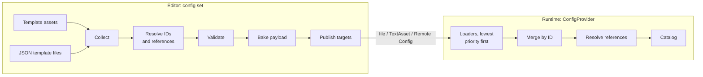

# Kott Configs

Typed game config data for Unity: authored in the editor, shipped as JSON, tuned without a new build.


Config data lives in **templates**: one ScriptableObject asset per enemy, item or level, referencing each other
and Addressables assets through normal Unity references. A **config set** collects templates (assets and JSON
files), validates them and bakes them into one JSON payload, which it publishes to a file or Unity Remote Config.
At runtime, a **provider** loads payloads from layered sources (built-in baseline, override file, remote) and
gives typed access by ID, by type or by enum value.

## Features

- **Templates as ScriptableObjects**: edit them in the inspector, reference them with `TemplateReference<T>`
  and Addressables assets with `TemplateAssetReference<T>`. IDs are derived from the asset names.
- **JSON template files** next to the assets, for bulk or generated data; they may reference asset templates.
- **Config sets** with validation of the whole set at once (duplicate IDs, dangling references, references
  leaving the set, unknown fields, JSON errors with line numbers, unaddressable assets, enum gaps, …), shown in
  a health view with click-to-select and fix buttons.
- **Deterministic bake and publish targets**: a JSON file (a `TextAsset` for the build, `StreamingAssets`,
  anything your backend uploads) or Unity Remote Config, keyed per build version; custom targets.
- **Layered loaders**: later sources override earlier ones per template ID; required or optional, with timeouts
  and progress. Built in: `TextAsset`, file, Remote Config, and an editor loader that bakes the set on play.
- **Typed lookups**: `GetTemplate<T>(id)`, `GetCollection<T>()` including subtypes, `GetTemplate<T>(enumValue)`.
- **Stable type identifiers**: pin them with `[TemplateType]` so renaming a class doesn't break published data.
- **Scopes integration** (optional): `ConfigManager` loads configs while its scope initializes and is injected
  as `IConfigManager`.
- **Testing helpers**: `InMemoryConfigProvider` builds templates in code.

## Installation

Via [OpenUPM](https://openupm.com/packages/com.kott.configs/), which also resolves the
[Kott Utilities](https://github.com/Kott-Games/package-utilities) dependency:

```
openupm add com.kott.configs
```

Alternatively from git URLs. Unity can't resolve the Utilities dependency from a git URL by itself, so in
*Package Manager > + > Install package from git URL*, add in order:

```
https://github.com/Kott-Games/package-utilities.git#v1.0.0
https://github.com/Kott-Games/package-configs.git#v1.0.0
```

Addressables and Newtonsoft JSON are installed as dependencies. Optional packages unlock more:

| Package | Unlocks |
|---|---|
| [Kott Scopes](https://github.com/Kott-Games/package-scopes) (`com.kott.scopes`) | `ConfigManager` / `IConfigManager` |
| Remote Config (`com.unity.remote-config`) | `RemoteConfigLoader` |
| + Deployment (`com.unity.services.deployment`) | `RemoteConfigPublishTarget` (writes and deploys the `.rc` file) |

## Quick start

1. **Template classes.** Public (or `[SerializeField]`) fields are the data.

   ```csharp
   [TemplateGroup("Item")]                                  // IDs "Item+<asset name>"
   [CreateAssetMenu(menuName = "Configs/Item")]
   public class ItemTemplate : Template
   {
       public string DisplayName;
       public int Value = 1;
       public TemplateAssetReference<Sprite> Icon = new();  // Addressables address in the payload
   }

   [TemplateGroup("Enemy")]
   [CreateAssetMenu(menuName = "Configs/Enemy")]
   public class EnemyTemplate : Template
   {
       public int Health = 10;
       public List<TemplateReference<ItemTemplate>> Loot = new();
   }
   ```

2. **Templates.** *Assets > Create > Configs > Config Set* in a folder, add a *File* publish target to it, then
   create template assets in that folder or its subfolders (*Assets > Create > Configs > Item*).
3. **Push.** *Tools > Configs > Open Window*, select the set, **Push**: it validates, bakes, writes
   `<Set>TypeMapping.asset` and publishes `<Set>.json`.
4. **Load at runtime**, with or without Scopes:

   ```csharp
   using ConfigProvider configs = new(typeMapping, new ConfigLoader[]
   {
       new TextAssetLoader(baseline),                                  // the published <Set>.json
       new FileLoader(FileLoader.PathRoot.PersistentData, "overrides.json", skipIfMissing: true),
   });
   await configs.LoadAsync();

   EnemyTemplate goblin = configs.GetTemplate<EnemyTemplate>("Enemy+Goblin");
   IReadOnlyList<ItemTemplate> items = configs.GetCollection<ItemTemplate>();
   ```

   With Scopes, add a `ConfigManager` to a scope definition, set its type mapping and loaders in the inspector,
   and inject it: `[Inject] private IConfigManager _configs;`.

## Concepts



- **Template IDs** are `"<group>+<asset name>"` (`[TemplateGroup]`, inherited by subclasses; default: the class
  name). Renaming an asset changes its ID; references between assets follow automatically, references by ID
  (JSON files, game code) don't.
- **Type identifiers** in payloads are the class name without "Template", or `[TemplateType("…")]`. The set's
  `ConfigTypeMapping` asset maps them to classes at runtime; push keeps it up to date.
- **Config sets**: all template assets and `*.json` files (flat arrays of templates, the payload's format) in the
  set's folders. A template belongs to one set, IDs are unique within it, references stay inside it. Folders of
  different sets must not overlap. Typical: one set for the game, one per test fixture.
- **JSON template files** carry `Type` and `ID` explicitly, reference templates by ID and assets by address, and
  are read strictly (unknown fields are errors). Asset templates can't reference JSON templates (object
  references only point to assets).
- **Payload**: `{ "formatVersion": 1, "templates": [ … ] }`, ordered by ID, every field written. Newer format
  versions are rejected with a clear error; unknown fields are ignored, so older builds read newer data.
- **Publish targets**: `FilePublishTarget`, `RemoteConfigPublishTarget` (key per project version, see
  `ConfigVersionUtility`, so each build reads its own config branch), or subclass `ConfigPublishTarget`.
- **Loaders**: `TextAssetLoader`, `FileLoader` (`StreamingAssets`, persistent data, absolute path or URL),
  `RemoteConfigLoader`, `EditorLoader` (bakes a set in memory on load, editor only), or subclass
  `ConfigLoader`. Each has a `Required`/`Optional` policy and a timeout. Later loaders replace templates of
  earlier ones by ID, whole templates at a time; references are resolved after merging.
- **Enum mapping**: `[TemplateEnum(typeof(StatType))]` on a template class maps each enum value to the template
  `"<group>+<value name>"` (or `IdFormat`); `GetTemplate<StatTemplate>(StatType.Health)`. Validation warns about
  values without a template.
- **Loaded templates** are ScriptableObject instances owned by the provider: a reload or `Dispose` destroys the
  previous ones, so don't keep references across reloads.

## Editor tooling

- **Tools > Configs > Open Window**: set selector, Validate / Validate All / Push, and the health view: every
  issue with severity filter, click to select, double click to open (JSON at the line), Fix buttons.
- **Browse Templates**: the set's templates by type, with field columns.
- The set's inspector: Validate and Push. `ConfigPipeline.Build/Push/ValidateAll` do the same from code or CI.

## Testing

```csharp
using InMemoryConfigProvider configs = new();
configs.Add<ItemTemplate>("Item+Coin", item => item.Value = 2);

Assert.That(Shop.Price(configs, "Item+Coin"), Is.EqualTo(2));
```

`InMemoryConfigProvider` lives in `Kott.Configs.Testing` (reference it from your test assembly; it is compiled in the editor and in
test builds, not in regular player builds) and has the
provider's lookups. With Scopes, `InMemoryConfigManager` injects it as `IConfigManager`. To test real data, build
a set with `ConfigPipeline.Build(set)` and load its `Payload` through a `ConfigProvider`.

## Samples

**Configs Basics** (*Package Manager > Kott Configs > Samples*): a bestiary from one config set with template
assets and a JSON file, a subtype hierarchy, template and sprite references, an enum mapping, and a baseline plus
an override file you can edit while playing. Works without Scopes; its README walks through it.

## Limitations

- One asset per template; sub-asset templates are reported as errors.
- Overrides replace whole templates, not single fields.
- References from asset templates can only point to asset templates.
- No dedicated editor for JSON template files: they're plain text.
- Remote Config: payloads are limited by Remote Config's value size.

## License

[MIT](LICENSE.md)
